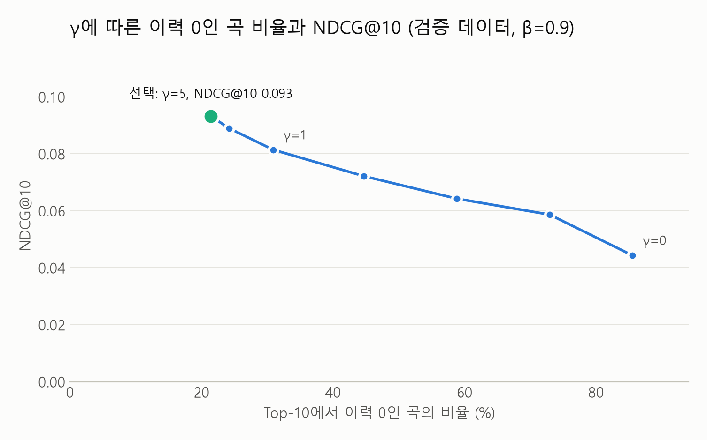
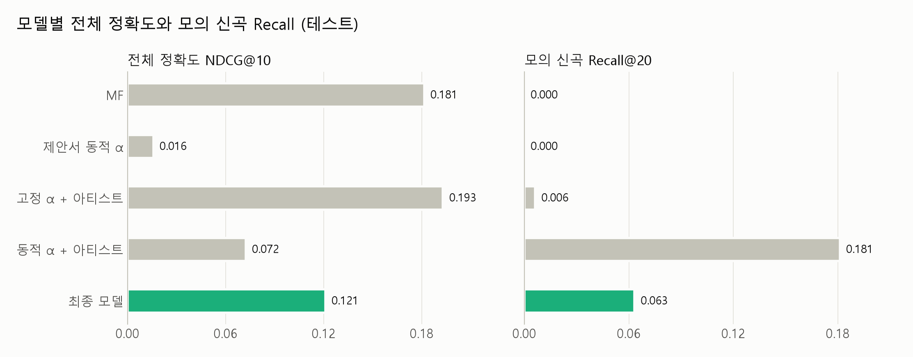
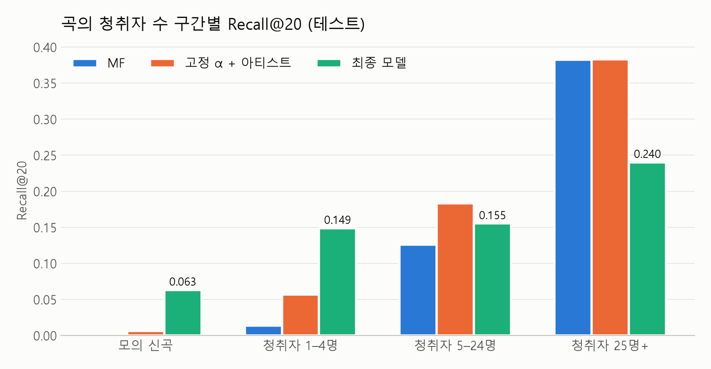
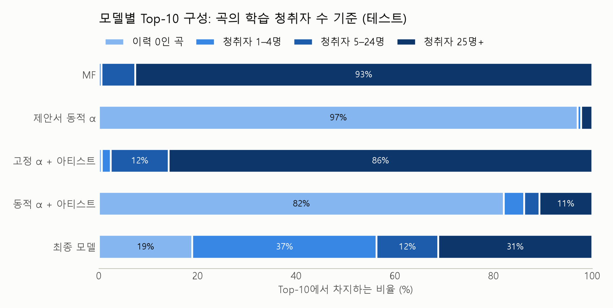

# 3단계 Hybrid Filtering — 실험과 결과

음악의 음향 특징과 사용자 청취 이력을 결합해 Cold-Start 문제를 완화하는 Team 11 프로젝트의 3단계입니다. 1단계 Content-Based(CB)와 2단계 Matrix Factorization(MF)의 점수를 결합해 사용자별 Top-N을 추천합니다. 1·2단계 코드는 수정하지 않고 사용합니다.

## 요약

| 지표 (테스트) | MF | 제안서 공식 그대로 | **최종 모델** |
|---|---|---|---|
| NDCG@10 | 0.1814 | 0.0158 | **0.1210** |
| 모의 신곡 Recall@20 | 0.0000 | 0.0000 | **0.0632** |
| Top-10 내 청취자 25명 이상 곡 비율 | 92.6% | 2.3% | **31.2%** |

- 제안서의 가중 결합 공식을 그대로 구현하니 Top-10의 97%가 청취 이력 0인 곡으로 채워졌습니다.
- 원인을 분석하고 다섯 단계의 실험을 거쳐, 아티스트 정보로 신곡의 점수를 추정하는 최종 모델을 만들었습니다.
- 최종 모델은 MF가 찾지 못하는 신곡과 비주류 곡을 찾고 인기곡 편중을 줄입니다. 대신 NDCG@10이 MF보다 33% 낮고, 사용자가 들어 보지 않은 아티스트의 신곡은 찾지 못합니다.

## 1. 문제 정의

기존 추천 시스템은 과거 재생 횟수에 의존하기 때문에, 재생 기록이 거의 없는 신곡이나 비주류 곡은 추천 후보에 오르지 못합니다. 그 결과 인기곡만 반복 추천되고 새로운 곡이 노출될 기회가 줄어듭니다.

이 정의에 맞춰 다음 네 가지를 함께 평가합니다.

| 문제 | 지표 |
|---|---|
| 신곡이 후보에 못 오름 | 모의 신곡 Recall@20 |
| 비주류 곡이 후보에 못 오름 | 청취자 1~4명, 5~24명 곡의 Recall@20 |
| 인기곡만 반복 추천 | Top-10 내 청취자 25명 이상 곡 비율, 카탈로그 커버리지, 사용자별 아티스트 수 |
| 그러면서 정확해야 함 | 전체 NDCG@10, Recall@10 |

## 2. 데이터와 평가 방법

**데이터**
- `Music Info.csv`: 50,683곡의 음향 특징 12개, 장르, 태그, 아티스트
- `User Listening History.csv`: 사용자 962,037명, 청취 기록 9,711,301행

**분할**
- 사용자의 5%를 추출해 사용자별로 곡의 80%를 학습, 20%를 테스트에 씁니다(시드 42). 곡을 5개 이상 들은 사용자 26,779명이 남고, 학습 336,182행, 테스트 97,181행입니다.
- 표본이 0.5%이면 전체 곡의 약 76%가 이력 0이 되어 곡마다 α가 거의 달라지지 않아서, 5%를 택했습니다.

**모의 신곡**
- 실제 신곡은 사용자가 들었는지 알 수 없어 채점할 수 없습니다. 그래서 학습 곡의 10%(2,085곡)를 골라 학습 기록을 모두 지우고, 테스트 기록은 남겨 정답으로 씁니다. 지운 뒤 학습 데이터는 303,364행입니다.
- 표본에 없어서 이력이 0인 곡은 실제 신곡이 아닐 수 있어 따로 집계하고, Cold-Start 판단에는 모의 신곡을 씁니다.

**설정 선택**
- 설정 값은 학습 데이터에서 떼어 낸 검증 데이터로 고르고, 실험 전에 기준을 정했습니다. 테스트는 결과 보고에만 씁니다.

**지표**
- 이미 들은 곡을 뺀 전체 카탈로그에서 순위를 매기고, 모든 모델을 같은 사용자, 후보, 정답으로 평가합니다.
- 테스트 표는 평가 사용자 2,000명 기준입니다. 구간별 Recall은 그 구간에 정답이 있는 사용자만 계산합니다(모의 신곡은 567명).

## 3. 기준 모델: 제안서 공식

```
S_Hybrid(u, i) = α(i)·S_CB(u, i) + (1 − α(i))·S_MF(u, i)
α(i) = 0.25 + 0.75 / (1 + n_i / 25)      n_i: 곡 i의 학습 청취자 수
```

`α`는 2단계의 `compute_dynamic_alpha`로 구합니다. 청취자가 없는 곡은 α=1, 청취자가 많을수록 α가 0.25에 가까워집니다. 고정 α를 쓰면 `S_MF=0`인 신곡의 점수가 0~α로 묶여 추천되기 어렵습니다.

| 모델 | NDCG@10 | Recall@10 | Top-10 내 이력 0 곡 비율 |
|---|---|---|---|
| CB | 0.0011 | 0.0012 | 62.8% |
| MF | 0.1814 | 0.2151 | 0.0% |
| 고정 α=0.25 | 0.1835 | 0.2158 | 0.0% |
| 동적 α | 0.0158 | 0.0159 | 97.1% |

**결과:** 동적 α는 Top-10을 이력 0인 곡으로 채웠고 정확도가 크게 떨어졌습니다. 신곡은 `S_CB`를 그대로 받아 0.9 이상이 되기 쉬운 반면, 이력이 있는 곡은 낮은 `S_MF`에 끌려 내려가기 때문입니다. 고정 α는 Top-10에 신곡이 나오지 않았습니다.

## 4. 실험

### 실험 1. 점수 보정 (`hybrid.py`)

**가설:** `S_CB`와 `S_MF`의 스케일이 달라서 쏠림이 생긴다.

| 보정 (동적 α) | NDCG@10 | Recall@10 | 모의 신곡 Recall@20 | Top-10 내 이력 0 곡 비율 |
|---|---|---|---|---|
| 없음 | 0.0158 | 0.0159 | 0.0000 | 97.1% |
| min-max | 0.0009 | 0.0013 | 0.0000 | 98.9% |
| 순위(백분위) | 0.0007 | 0.0012 | 0.0000 | 99.7% |

**결론:** 가설은 기각되었습니다. 보정하면 오히려 나빠지고, 검증에서도 보정 없음이 선택되었습니다. CB가 모의 신곡 정답을 평균 약 1.8만 등(백분위 0.643)에 두어 Top-20에 들지 못한다는 점이 드러나, CB의 신호를 강화하는 쪽으로 방향을 바꿨습니다.

### 실험 2. 스케일러 교체 (`scaler_experiment.py`)

**가설:** StandardScaler가 일부 특징에 맞지 않는다. `key`, `mode`, `time_signature`는 값이 12, 2, 5종류뿐이고, `speechiness`(왜도 3.86), `liveness`(2.03), `loudness`(−1.70), `acousticness`(1.32), `instrumentalness`(1.14)는 분포가 치우쳐 있습니다.

**선택 기준:** 검증 데이터의 모의 신곡 백분위

| 스케일러 | 검증 백분위 | 테스트 백분위 | CB NDCG@10 | CB 모의 신곡 Recall@20 | 동적 α NDCG@10 | 고정 α=0.25 NDCG@10 |
|---|---|---|---|---|---|---|
| standard (기존) | 0.660 | 0.643 | 0.0011 | 0.0000 | 0.0158 | 0.1835 |
| robust | 0.610 | 0.583 | 0.0009 | 0.0018 | 0.0099 | 0.1832 |
| minmax | 0.630 | 0.614 | 0.0044 | 0.0115 | 0.0401 | 0.1824 |
| quantile_normal | 0.601 | 0.608 | 0.0005 | 0.0044 | 0.0164 | 0.1792 |
| skew_aware | 0.669 | 0.648 | 0.0011 | 0.0004 | 0.0131 | 0.1842 |
| **categorical_onehot (선택)** | **0.675** | **0.657** | 0.0013 | 0.0022 | 0.0305 | 0.1831 |
| no_categorical | 0.673 | 0.651 | 0.0017 | 0.0000 | 0.0093 | 0.1822 |

**결론:** 범주형과 치우친 특징을 처리하면 조금 나아지지만 쏠림(94% 이상)은 남습니다. 다른 사용자의 취향으로 점수를 내면 standard의 백분위가 0.637에서 0.516으로 떨어져(신곡 정답이 있는 사용자 표본), CB의 신호는 약하지만 사용자별 취향을 반영한다는 것을 확인했습니다.

### 실험 3. 아티스트 선호도 추가 (`artist_experiment.py`)

**가설:** 음악 취향에서는 아티스트가 음향 유사도보다 강한 신호다. 기존 CB에는 아티스트가 빠져 있습니다.

```
S_CB' = (1 − β)·S_CB + β·A(u, 아티스트)
A = 사용자의 아티스트별 log(1 + 재생 횟수) 합 / 그 사용자의 최댓값
```

**선택 기준:** 검증 데이터의 모의 신곡 Recall@20. 스케일러 3종과 β 6개를 비교해 `standard`, `β=0.9`가 선택되었습니다.

| 지표 (테스트) | 기존 CB | 아티스트 추가 |
|---|---|---|
| CB NDCG@10 | 0.0011 | 0.0588 |
| CB 모의 신곡 Recall@20 | 0.0000 | 0.1464 |
| 동적 α NDCG@10 | 0.0158 | 0.0723 |
| 동적 α 모의 신곡 Recall@20 | 0.0000 | 0.1811 |
| 동적 α Top-10 내 이력 0 곡 비율 | 97.1% | 82.1% |
| 고정 α=0.25 NDCG@10 | 0.1835 | 0.1930 |
| 고정 α=0.25 모의 신곡 Recall@20 | 0.0000 | 0.0062 |

**결론:** 처음으로 모의 신곡을 찾았습니다. 그러나 동적 α는 쏠림이 남아 정확도가 낮고, 고정 α는 신곡이 거의 나오지 않습니다. 신곡의 `S_MF`가 0이라는 근본 원인을 해결해야 합니다.

### 실험 4. 아티스트로 신곡의 S_MF 추정 (`artist_mf_experiment.py`)

**가설:** 신곡도 MF 점수를 가지면 같은 순위에서 공정하게 경쟁한다.

```
S_MF(u, 신곡) = 같은 아티스트의 학습 곡 S_MF 평균
α(신곡) = compute_dynamic_alpha(n = γ × 그 곡들의 평균 청취자 수)
```

**선택 기준:** 검증 NDCG@10이 `고정 α + 아티스트`의 90%(0.1253) 이상인 설정 중 모의 신곡 Recall@20이 가장 높은 값. 충족하는 설정이 없으면 NDCG@10이 가장 높은 값.

처음에는 `β=0.5, γ=1`이 선택되었는데 γ가 후보의 끝값이어서, γ를 10까지 넓혀 한 번 더 실험했습니다. **두 차례 모두 기준은 충족하지 못했고**, 규칙에 따라 `β=0.9, γ=5`(검증 NDCG@10 0.0932)가 선택되었습니다.

| 지표 (테스트) | MF | 고정 α + 아티스트 | 동적 α + 아티스트 | **`β=0.9, γ=5`** |
|---|---|---|---|---|
| NDCG@10 | 0.1814 | 0.1930 | 0.0723 | **0.1213** |
| Recall@10 | 0.2151 | 0.2266 | 0.0872 | **0.1419** |
| 모의 신곡 Recall@20 | 0.0000 | 0.0062 | 0.1811 | **0.0870** |
| 청취자 1~4명 곡 Recall@20 | 0.0138 | 0.0566 | 0.0822 | **0.1215** |
| 청취자 5~24명 곡 Recall@20 | 0.1260 | 0.1831 | 0.0893 | **0.1713** |
| Top-10 내 청취자 25명 이상 곡 비율 | 92.6% | 85.8% | 10.7% | **25.1%** |
| Top-10 내 이력 0 곡 비율 | 0.0% | 0.6% | 82.1% | **18.6%** |

**결론:** 쏠림이 크게 줄고 비주류 곡을 찾는 능력이 올랐습니다. 다만 사용자별 Top-10이 평균 2.33명의 아티스트에 몰리는 새로운 문제가 생겼습니다(MF는 6.64명).



### 실험 5. 아티스트당 곡 수 제한 (`artist_cap_experiment.py`)

**가설:** 점수를 바꾸지 않고 목록만 조정해도 아티스트 쏠림을 줄일 수 있다. Top-20에는 제한의 2배를 적용합니다.

**선택 기준:** 검증 NDCG@10과 모의 신곡 Recall@20이 모두 제한 없음의 90% 이상인 값 중 가장 강한 제한. **5곡**이 선택되었습니다.

| 지표 (테스트) | 제한 없음 | **5곡 (선택)** | 3곡 | 2곡 | 1곡 |
|---|---|---|---|---|---|
| NDCG@10 | 0.1213 | **0.1210** | 0.1207 | 0.1216 | 0.1174 |
| 모의 신곡 Recall@20 | 0.0870 | **0.0632** | 0.0363 | 0.0254 | 0.0143 |
| 청취자 1~4명 곡 Recall@20 | 0.1215 | **0.1488** | 0.1561 | 0.1540 | 0.1204 |
| 청취자 5~24명 곡 Recall@20 | 0.1713 | **0.1553** | 0.1209 | 0.0948 | 0.0629 |
| Top-10 평균 아티스트 수 | 2.33 | **3.52** | 5.11 | 6.72 | 10.00 |
| Top-10 중 들어 본 아티스트의 곡 비율 | 94.4% | **87.1%** | 77.3% | 65.5% | 42.9% |
| Top-10 내 청취자 25명 이상 곡 비율 | 25.1% | **31.2%** | 40.6% | 50.8% | 68.9% |

**결론:** 정확도는 거의 변하지 않고 아티스트는 다양해집니다. 대신 제한이 강할수록 모의 신곡 Recall이 떨어지고 인기곡 비율이 다시 오릅니다. 모델이 신곡을 들어 본 아티스트에서 찾기 때문으로 보입니다.

## 5. 최종 모델 (`final_model.py`)

```
S_CB' = 0.1 × S_CB + 0.9 × A(u, 아티스트)
S_Hybrid = α(i) × S_CB' + (1 − α(i)) × S_MF
신곡의 S_MF = 같은 아티스트의 학습 곡 S_MF 평균
신곡의 α = compute_dynamic_alpha(n = 5 × 그 곡들의 평균 청취자 수)
추천 목록 = S_Hybrid 순서대로, 아티스트당 Top-10에 최대 5곡
```

| 지표 (테스트) | MF | 고정 α + 아티스트 | **최종 모델** |
|---|---|---|---|
| NDCG@10 | 0.1814 | 0.1930 | **0.1210** |
| Recall@10 | 0.2151 | 0.2266 | **0.1397** |
| 모의 신곡 Recall@20 | 0.0000 | 0.0062 | **0.0632** |
| 청취자 1~4명 곡 Recall@20 | 0.0138 | 0.0566 | **0.1488** |
| 청취자 5~24명 곡 Recall@20 | 0.1260 | 0.1831 | **0.1553** |
| 청취자 25명 이상 곡 Recall@20 | 0.3827 | 0.3828 | **0.2403** |
| Top-10 내 청취자 25명 이상 곡 비율 | 92.6% | 85.8% | **31.2%** |
| 카탈로그 커버리지 (전체 사용자 합산) | 6.1% | 7.9% | **12.9%** |
| 사용자별 Top-10의 평균 아티스트 수 | 6.64 | 5.05 | **3.52** |
| Top-10 중 들어 본 아티스트의 곡 비율 | 46.4% | 67.3% | **87.1%** |

**사용자별 차이의 95% 신뢰구간 (부트스트랩, 최종 모델 − 비교 모델)**

| 비교 | 평균 차이 | 95% 신뢰구간 |
|---|---|---|
| NDCG@10, MF | −0.0605 | −0.0678 ~ −0.0534 |
| NDCG@10, 고정 α + 아티스트 | −0.0720 | −0.0785 ~ −0.0655 |
| NDCG@10, 곡 수 제한 전 | −0.0004 | −0.0032 ~ +0.0025 |
| 모의 신곡 Recall@20, 고정 α + 아티스트 (567명) | +0.0570 | +0.0385 ~ +0.0770 |
| 모의 신곡 Recall@20, 곡 수 제한 전 (567명) | −0.0238 | −0.0415 ~ −0.0079 |







수치는 `hybrid_output/figures/figure_data.csv`에도 있습니다.

## 6. 한계

- **정확도 손실:** NDCG@10이 MF보다 33%, `고정 α + 아티스트`보다 37% 낮습니다. 정확도만 본다면 `고정 α + 아티스트`가 가장 높지만, 신곡이 거의 추천되지 않아 프로젝트 목표에 맞지 않습니다.
- **찾을 수 있는 신곡의 범위:** 사용자가 들어 본 아티스트의 신곡만 찾습니다. 모의 신곡 정답 중 이런 곡은 49%이고 Recall@20은 0.1386이며, 나머지 51%는 0입니다.
- **아티스트 쏠림:** 5곡 제한 후에도 Top-10이 평균 3.52명의 아티스트에 몰립니다. 인기곡 반복은 줄었지만 같은 아티스트 반복으로 바뀐 면이 있습니다.
- **이력 0인 곡과 신곡의 차이:** Top-10의 이력 0인 곡 18.9% 중 모의 신곡은 1.2%포인트이고, 나머지는 표본에 없어서 이력이 0인 곡입니다.
- **S_MF 추정의 성격:** 사용자가 들은 곡의 `S_MF`는 대부분 1.0으로 잘리므로, 추정값은 상당 부분 "이 아티스트를 들어 봤는가"를 나타내고 `A`와 겹칩니다.
- **결합의 효과:** 곡 수 제한 전 기준으로, 최종 모델의 `S_MF`만 쓰면 NDCG@10(0.1533)과 모의 신곡 Recall@20(0.1024)이 더 높습니다. 결합의 이득은 주로 청취자가 적은 기존 곡을 찾는 데서 나옵니다(1~4명 곡 Recall@20 0.1215 대 0.0104).
- **평가의 독립성:** 설정 값은 검증 데이터로 골랐지만, 연속된 실험에서 테스트 결과를 보며 다음 방향을 정했으므로 최종 수치가 완전히 독립적인 평가는 아닙니다. 선택 기준도 두 차례 충족하지 못했습니다.
- **신뢰구간의 범위:** 사용자 표본의 불확실성만 반영합니다. 모의 신곡 목록과 ALS 시드는 하나로 고정했습니다.
- **두 번째 데이터셋:** 이 문서의 결과는 MSD 기반 데이터 하나에서 얻은 것입니다. Spotify 평가는 실제 데이터로 실행하지 않았습니다. `hybrid.py --spotify`는 합성 데이터로만 테스트했고, 최종 모델이 아니라 제안서 공식을 평가합니다.
- **제안서와의 차이:** 제안서는 Librosa 특징과 SGD 학습을 명시하지만, 코드는 사전 계산된 음향 특징과 ALS 기본값을 씁니다. K-Means 군집은 추천 점수에 쓰이지 않습니다.

**개선 방향:** 사용자가 들어 보지 않은 아티스트의 곡을 찾으려면 곡의 음향 특징과 태그로 MF 곡 벡터를 예측하는 방법을 시도할 수 있습니다.

## 7. 파일 구성과 실행

| 파일 | 내용 |
|---|---|
| `final_model.py` | 최종 모델, 평가, 추천 |
| `hybrid.py` | 제안서 공식, 평가 지표, 공통 분할 생성 |
| `scaler_experiment.py` | 실험 2 |
| `artist_experiment.py` | 실험 3 |
| `artist_mf_experiment.py` | 실험 4 |
| `artist_cap_experiment.py` | 실험 5 |
| `make_figures.py` | 결과 그림 |
| `test_*.py` | 단위 테스트 (실제 데이터 불필요) |
| `hybrid_output/` | 실험 결과와 그림 |

```bash
pip install -r requirements_hybrid.txt

# 공통 분할 생성 (필요한 파일: Music Info.csv, User Listening History.csv)
python hybrid.py make-split --music "Music Info.csv" --history "User Listening History.csv" --user-fraction 0.05

# 최종 모델 평가와 추천
python final_model.py evaluate --music "Music Info.csv" --train-history shared_train_history.csv --test-history shared_test_history.csv
python final_model.py recommend --music "Music Info.csv" --train-history shared_train_history.csv --user USER_ID --top-n 10

# 실험 재현
python hybrid.py evaluate --output hybrid_output/rank
python scaler_experiment.py
python artist_experiment.py
python artist_mf_experiment.py
python artist_mf_experiment.py --betas 0.5 0.9 --gammas 1 2 5 10 --output hybrid_output/artist_mf_gamma
python artist_cap_experiment.py

# 그림
python make_figures.py

# 테스트
python -m unittest test_artist_cap_experiment.py test_make_figures.py test_final_model.py test_artist_mf_experiment.py test_artist_experiment.py test_scaler_experiment.py test_hybrid.py test_collaborative.py test_content_based.py
```

데이터 파일과 `shared_*_history.csv`는 용량 때문에 저장소에 포함하지 않습니다. 실험 하나에 약 20~50분 걸립니다.
