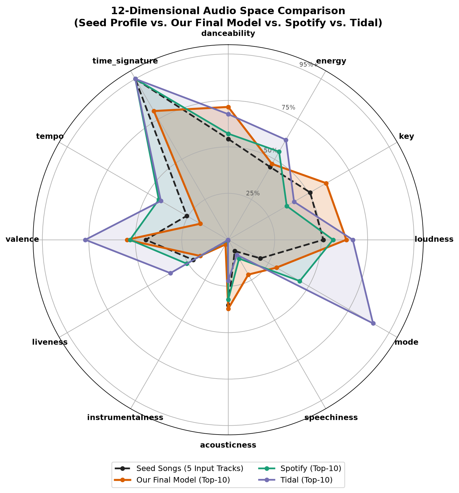

# 사례 연구(Case Study) — 12차원 음향 공간에서의 우리 최종 모델 vs. Spotify vs. Tidal 비교

| 비교 지표 (12차원 표준화 음향 공간) | **우리 최종 모델 (Final)** | **Spotify (Top-10 중 9곡)** | **Tidal (Top-10)** | 해석 |
| --- | :---: | :---: | :---: | --- |
| **Profile Similarity (취향 일관성, 0~1)** | **0.7216** | 0.6409 | 0.5177 | 5개 시드 곡 평균 벡터와의 코사인 유사도 (높을수록 시드 분위기에 밀착) |
| **Profile Similarity (원시 코사인, -1~1)** | **+0.4432** | +0.2818 | +0.0353 | 12차원 Z-점수 공간에서의 중심 벡터 코사인 유사도 |
| **Intra-List Diversity (목록 내 다양성, 0~1)** | 0.3867 | **0.4782** | 0.3931 | $1 - \text{추천 곡 쌍 간 평균 코사인 유사도}$ (높을수록 의외성·다양성 큼) |
| **Intra-List Diversity (원시 코사인 기준)** | 0.7734 | **0.9564** | 0.7863 | 추천 목록 내 모든 곡 쌍의 평균 음향적 거리 |
| **음향 지표 계산에 사용된 검증 곡 수** | 10 / 10 | 9 / 10 | 10 / 10 | 데이터셋에 없는 곡(*I'm Still Standing*)은 임의 추정 없이 제외 |
| **Top-10 내 고유 아티스트 수** | 4명 (최대 5곡 제한) | **10명** | **10명** | 우리 모델은 시드 아티스트 중심, 상용 서비스는 10곡 모두 다른 아티스트 |

## 1. 실험 목적

정량 지표(NDCG@10, Recall@20)만으로는 추천 목록이 실제로 **어떤 음악적 분위기**를 띠는지 직관적으로 체감하기 어렵습니다. 이 사례 연구는 서로 다른 장르의 대표 명곡 5곡을 **우리 최종 모델(`Final`, `β=0.9, γ=5, 아티스트당 최대 5곡 제한`)**과 실제 상용 스트리밍 서비스인 **Spotify**, **Tidal**에 동일하게 입력했을 때, 세 시스템이 내놓는 Top-10 추천 목록이 **12차원 음향 공간(12-Dimensional Audio Space)**에서 어떤 성향 차이를 보이는지 비교하기 위해 진행했습니다.

## 2. 비교 과정 및 지표 설계

**1) 공통 입력 시드(Seed) 5곡**
팝, 그런지 록, 소울/R&B, 재즈, 하드 록을 대표하는 아래 5곡을 공통 입력 시드로 넣었습니다.
- **Michael Jackson — *Beat It*** (`danceability 0.771`, `energy 0.792`, 단조 `mode=0`)
- **Nirvana — *Come as You Are*** (`energy 0.826`, `tempo 120.0 BPM`, 단조 `mode=0`)
- **Amy Winehouse — *Back to Black*** (`energy 0.725`, `valence 0.335`, 장조 `mode=1`, 학습 청취자 10명)
- **Miles Davis — *Blue in Green*** (`acousticness 0.811`, `energy 0.034`, `tempo 57.9 BPM`, 단조 `mode=0`)
- **Led Zeppelin — *Stairway to Heaven*** (`acousticness 0.625`, `energy 0.361`, `tempo 80.4 BPM`, 단조 `mode=0`, 학습 청취자 4명)

5곡 중 4곡이 단조(`mode 평균 = 0.20`)이며, 어쿠스틱한 재즈·록 발라드와 강렬한 밴드 사운드가 섞여 있어 평균 에너지(`0.548`), 어쿠스틱니스(`0.317`), 밝기(`valence = 0.428`), 템포(`104.1 BPM`)가 차분하고 입체적인 프로필을 형성합니다.

**2) 외부 추천 목록의 음향 특징 매칭 (`scripts/build_case_study_features.py`)**
외부 추정치로 인한 오차를 막기 위해 모든 음향 수치는 프로젝트 내 검증된 두 데이터셋(`Music Info.csv` 우선, 없으면 `spotify_songs.csv`)에서만 조회합니다.
- `spotify_songs.csv`에서 가져온 곡은 `time_signature` 열이 없으므로 `hybrid.load_spotify`와 동일한 규칙(`Music Info.csv` 학습 중앙값 `4`)으로 채웁니다.
- Spotify 추천 9위 *Elton John — I'm Still Standing*은 두 데이터셋 모두에 수록되어 있지 않아 임의 수치를 넣지 않고 음향 평균 계산에서 제외했습니다(따라서 Spotify 지표는 검증된 9곡 기준).
- Tidal 추천 4위 `i got you`는 곡명만 기록되어 있어 동명 곡 중 80년대 뉴웨이브 대표곡인 *Split Enz — I Got You*(`spotify_songs.csv` 수록)로 매칭했습니다(*James Brown — I Got You (I Feel Good)* 등 다른 동명 곡일 가능성 있음).

**3) 12차원 음향 공간 투영 및 평가 지표**
`Music Info.csv`(50,683곡)에 학습된 `StandardScaler`로 시드 5곡과 각 모델의 추천 목록을 동일한 **12차원 음향 공간**으로 변환한 뒤 두 지표를 계산했습니다.
- **Profile Similarity (Cohesion, 취향 일관성):** 시드 5곡의 12차원 평균 벡터와 추천된 각 곡 벡터 사이의 평균 코사인 유사도입니다. 높을수록 입력 시드의 전체적인 음향 분위기를 충실히 유지함을 뜻합니다.
- **Intra-List Diversity (Serendipity, 목록 내 다양성·의외성):** 추천 목록 내부의 모든 곡 쌍($\binom{N}{2}$쌍) 간 평균 코사인 유사도를 1에서 뺀 값($1 - \bar{s}_{\text{pair}}$)입니다. 높을수록 한 목록 안에 다양한 스타일과 템포의 곡이 넓게 분포함을 뜻합니다.

## 3. 결과 분석



### 3.1 세 모델의 추천 Top-10 목록 비교

| 순위 | **우리 최종 모델 (Final)** | **Spotify 추천 (Top-10)** | **Tidal 추천 (Top-10)** |
| :---: | --- | --- | --- |
| 1 | Amy Winehouse — *I Heard Love Is Blind* (이력 17) | The Mamas & the Papas — *California Dreamin'* | Alphaville — *Forever Young* |
| 2 | Amy Winehouse — *Half Time* (이력 1) | Chris Isaak — *Wicked Game* | ABBA — *Mamma Mia* |
| 3 | Amy Winehouse — *What Is It About Men* (이력 15) | Queen — *Bohemian Rhapsody* | Bonnie Tyler — *Total Eclipse of the Heart* |
| 4 | Amy Winehouse — *Intro / Stronger Than Me* (이력 1) | Tears for Fears — *Everybody Wants to Rule the World* | Split Enz — *I Got You* |
| 5 | Miles Davis — *Bitches Brew* (이력 1) | Aerosmith — *Dream On* | David Bowie — *Let's Dance* |
| 6 | Amy Winehouse — *Some Unholy War* (이력 15) | The Verve — *Bitter Sweet Symphony* | Bruce Springsteen — *Born in the U.S.A.* |
| 7 | Michael Jackson — *This Time Around* (이력 1) | Bill Withers — *Ain't No Sunshine* | The Jackson 5 — *I Want You Back* |
| 8 | Led Zeppelin — *Kashmir* (이력 1) | George Michael — *Careless Whisper* | Mark Ronson — *Uptown Funk* |
| 9 | Led Zeppelin — *All My Love* (이력 1) | Elton John — *I'm Still Standing* *(미수록 제외)* | Joan Jett and the Blackhearts — *I Love Rock 'n' Roll* |
| 10 | Led Zeppelin — *I Can't Quit You Baby* (이력 1) | Sade — *Smooth Operator* | Bon Jovi — *Livin' On A Prayer* |

### 3.2 모델별 추천 성향 및 음향 공간 해석

1. **우리 최종 모델 (`Cohesion = 0.7216`, `Diversity = 0.3867`) — 시드 분위기 밀착 + 시드 아티스트의 숨은 곡 발굴:**
   - 시드 5곡 중 ALS 학습 이력이 있는 *Amy Winehouse*(`Back to Black`)와 *Led Zeppelin*(`Stairway to Heaven`)에서 협업 신호($S_{MF}$)가 강하게 작동하고, 아티스트 선호도($\beta=0.9$)와 아티스트당 5곡 제한(`cap=5`)이 결합되어 *Amy Winehouse* 5곡, *Led Zeppelin* 3곡, *Miles Davis* 1곡(*Bitches Brew*), *Michael Jackson* 1곡(*This Time Around*)이 추천되었습니다.
   - 특히 청취자 수가 1명뿐인 비주류 곡 7곡을 끌어올리면서도, 시드 5곡의 단조 비율(`mode 0.20` $\to$ `0.30`), 에너지(`0.548` $\to$ `0.563`), 어쿠스틱니스(`0.317` $\to$ `0.335`), 템포(`104.1` $\to$ `95.9 BPM`)를 가장 비슷하게 유지해 **취향 일관성(0.7216)이 세 시스템 중 가장 높게** 나타났습니다.

2. **Spotify (`Cohesion = 0.6409`, `Diversity = 0.4782`) — 시드 장르들의 교집합을 새로운 아티스트로 넓힌 서렌디피티(Serendipity) 추천:**
   - Spotify는 시드 아티스트를 그대로 반복하지 않고 10곡 모두 새로운 아티스트로 채우면서도, *Stairway to Heaven*의 대곡 록 감성(*Bohemian Rhapsody*, *Dream On*)과 *Back to Black*·*Blue in Green*의 소울/재즈 감성(*Ain't No Sunshine*, *Smooth Operator*, *Wicked Game*)을 골고루 반영했습니다.
   - 단조 비율(`mode = 0.444`)과 어쿠스틱니스(`0.291`), 밝기(`valence = 0.498`)가 시드 중심을 잘 따라가면서(일관성 2위, `0.6409`), 느린 소울 발라드(`79.6 BPM`)부터 빠른 브릿팝(`171.1 BPM`)까지 가장 넓게 펼쳐져 **목록 내 다양성(0.4782) 1위**를 기록했습니다.

3. **Tidal (`Cohesion = 0.5177`, `Diversity = 0.3931`) — *Beat It*의 80년대 팝/록 에너지 쪽으로 쏠린 밝은 추천:**
   - Tidal은 시드 5곡 중 *Beat It*의 80년대 업템포 팝·록 성향에 집중해 *ABBA*, *Alphaville*, *David Bowie*, *Bon Jovi*, *Uptown Funk* 등을 추천했습니다.
   - 그 결과 추천된 10곡 중 **9곡이 장조(`mode = 0.900`)**이고 밝기(`valence = 0.699`)와 에너지(`0.682`)가 크게 치우쳐, 단조(80%)와 어쿠스틱·재즈·소울 비중이 높았던 원래 시드 5곡과의 **취향 일관성(0.5177, 원시 코사인 +0.0353)**이 세 시스템 중 가장 낮게 나타났습니다.

### 3.3 12차원 음향 특징 평균 비교표 (레이더 차트 수치)

| 음향 특징 (12 Features) | **입력 시드 5곡 평균** | **우리 최종 모델** | **Spotify (9곡)** | **Tidal (10곡)** | 레이더 차트 비교 요약 |
| --- | :---: | :---: | :---: | :---: | --- |
| `danceability` | 0.519 | 0.621 | **0.536** | 0.598 | Spotify가 시드 평균(0.519)에 가장 근접 |
| `energy` | 0.548 | **0.563** | 0.623 | 0.682 | 우리 모델(0.563)이 시드 에너지(0.548)와 거의 일치 |
| `key` | 5.600 | **6.700** | 4.000 | 4.500 | 우리 모델과 Tidal이 시드 조성 평균 주변에 위치 |
| `loudness` (dB) | -9.866 | -8.179 | **-9.155** | -7.707 | Spotify(-9.16dB)와 우리 모델(-8.18dB)이 시드 음압에 근접 |
| `mode` (장조 비율) | 0.200 | **0.300** | 0.444 | 0.900 | 시드(단조 위주, 0.20)의 분위기를 우리 모델(0.30)이 가장 잘 보존 |
| `speechiness` | 0.042 | 0.070 | 0.051 | **0.046** | 세 모델 모두 낮은 speechiness 유지 |
| `acousticness` | 0.317 | **0.335** | 0.291 | 0.199 | 우리 모델(0.335)과 Spotify(0.291)가 어쿠스틱 비중을 잘 반영 |
| `instrumentalness` | 0.003 | 0.026 | **0.004** | 0.001 | 세 모델 모두 보컬 중심 트랙 추천 |
| `liveness` | 0.187 | 0.162 | **0.211** | 0.270 | Spotify(0.211)와 우리 모델(0.162)이 시드(0.187)와 유사 |
| `valence` (밝기/긍정도) | 0.428 | 0.511 | **0.498** | 0.699 | 우리 모델과 Spotify는 시드의 차분한 정서 유지, Tidal은 밝은 곡 편중 |
| `tempo` (BPM) | 104.083 | **95.871** | 120.988 | 119.716 | 우리 모델이 느린 재즈·소울 템포를 반영해 시드 템포에 가장 가까움 |
| `time_signature` | 4.000 | 3.800 | **4.000** | **4.000** | 우리 모델은 3/4박자 재즈/소울 트랙 일부 포함 |

## 4. 실행 방법

```bash
# 1) 데이터셋에서 Spotify / Tidal 추천 곡의 음향 특징 CSV 생성
python scripts/build_case_study_features.py

# 2) 5개 시드 곡(Beat It, Come as You Are, Back to Black, Blue in Green, Stairway to Heaven) 기준 비교 실행
python -m experiments.case_study.case_study_experiment \
    --spotify-recs data/case_study/spotify_recommended_features.csv \
    --tidal-recs data/case_study/tidal_recommended_features.csv \
    --music "data/Music Info.csv" \
    --train-history outputs/content_based/demo_train_history.csv \
    --output outputs/hybrid/case_study
```
