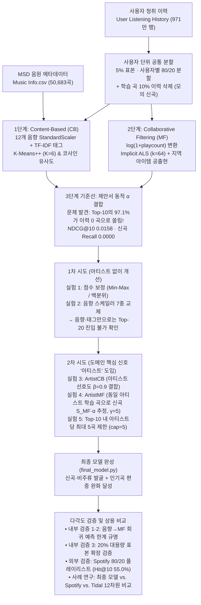
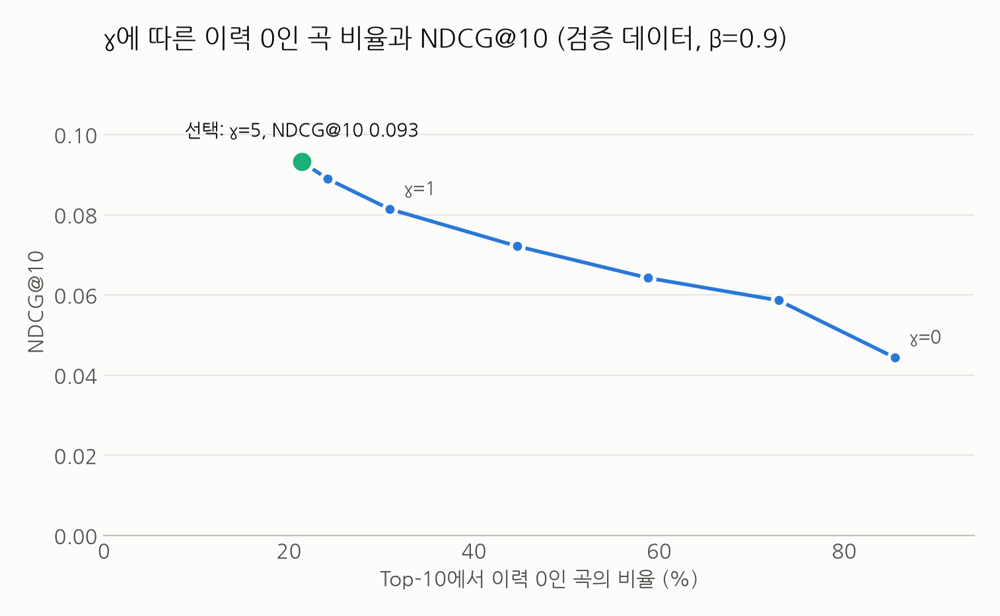
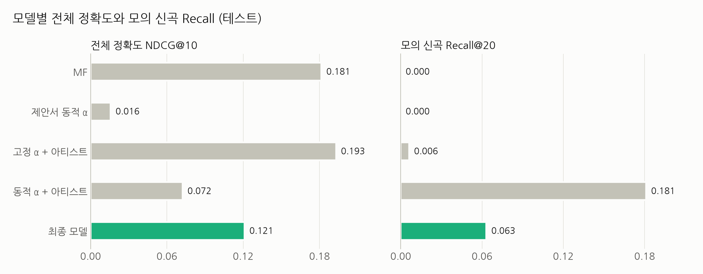
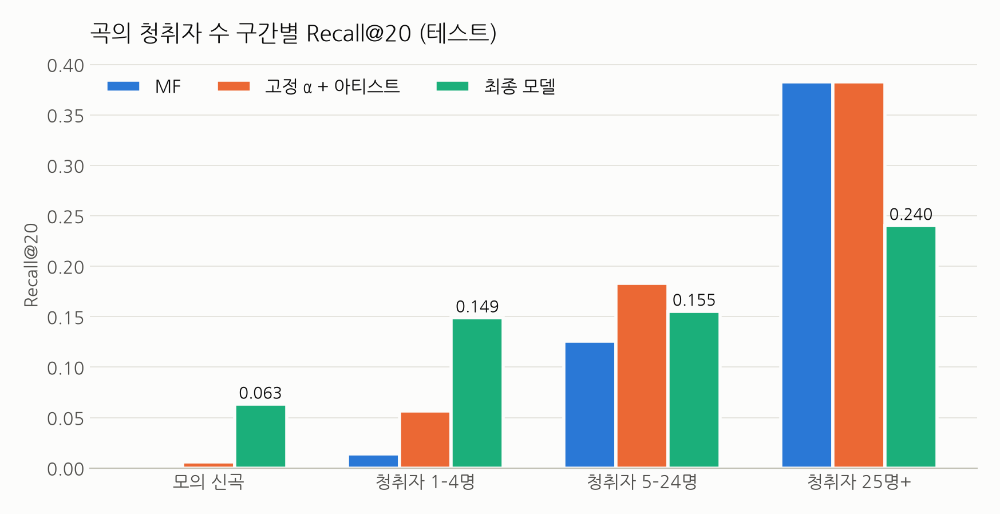
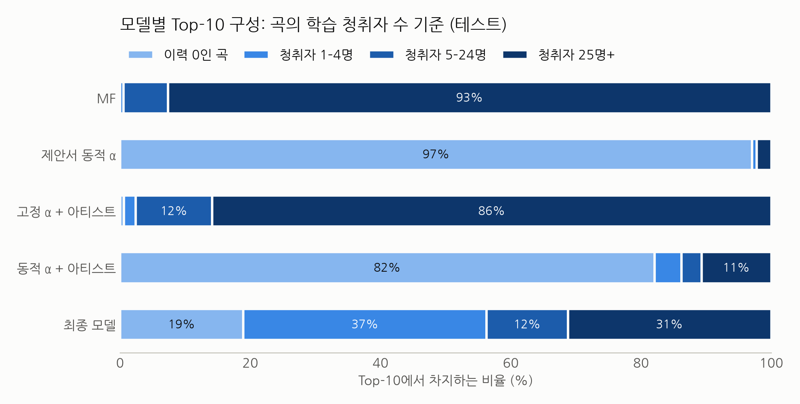
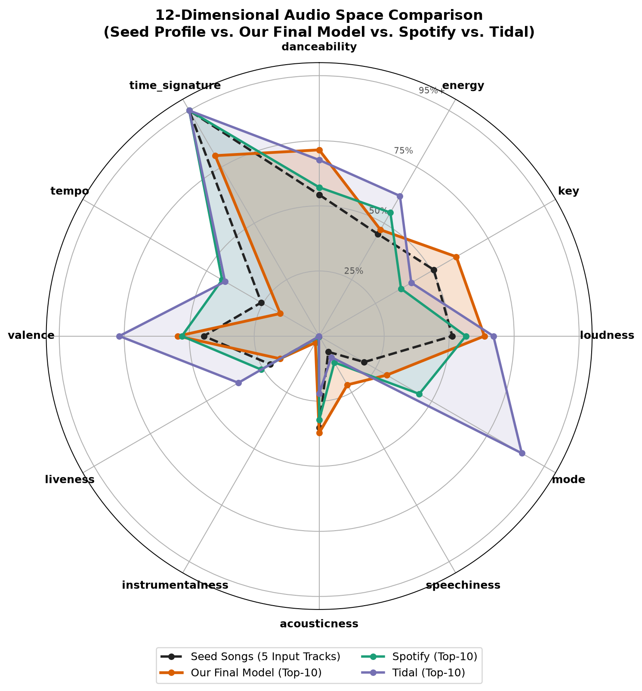

# 하이브리드 음악 추천 시스템 — 전체 프로젝트 기술 및 실험 총괄 문서

> **문서 목적:** 본 문서는 팀원 누구나 프로젝트 전체의 **설계 논리, 핵심 알고리즘과 수식, 실험·검증 과정, 결과 해석 및 한계**를 한 번에 이해하고, 기말 최종 보고서 및 발표 자료의 레퍼런스로 바로 활용할 수 있도록 작성된 종합 기술 문서입니다.

---

## 1. 프로젝트 한눈에 보기 (Executive Summary)

### 1.1 우리가 풀고자 한 핵심 문제
음악 추천 시스템의 대표 방식인 **협업 필터링(Collaborative Filtering, MF)**은 과거 사용자들의 청취 이력만으로 놀라울 만큼 정확한 추천을 제공하지만, 치명적인 두 가지 한계를 가집니다.
1. **Cold-Start 문제:** 새로 발매된 곡(신곡)이나 청취 이력이 없는 곡은 모델 안에 잠재 벡터 자체가 없어 **점수가 항상 `0`이 되며 추천 후보에 절대 오르지 못합니다.**
2. **인기곡 편중(Popularity Bias):** 청취 기록이 많은 소수의 인기곡만 반복 추천되어(실제 실험에서 MF Top-10의 **92.6%**가 상위 인기곡), 숨은 명곡이나 비주류(Long-tail) 곡이 노출될 기회가 사라집니다.

반대로 음향 특징(템포, 에너지, 어쿠스틱니스 등)과 태그를 쓰는 **콘텐츠 기반 필터링(Content-Based Filtering, CB)**은 청취 이력이 전혀 없는 신곡도 즉시 점수를 매길 수 있지만, **음향만으로는 개인의 세밀한 음악 취향을 구분하기 어려워 추천 정확도가 매우 낮습니다.**

### 1.2 핵심 해결 전략과 여정 요약
본 프로젝트는 **50,683곡의 음향·메타데이터(`Music Info.csv`)**, **971만 건의 사용자 청취 이력(`User Listening History.csv`)**, 그리고 **외부 최신 스트리밍 플레이리스트 데이터(`spotify_songs.csv`)**를 결합해 이 딜레마를 단계적으로 해결했습니다.



### 1.3 핵심 성과 요약표

| 평가 환경 및 핵심 지표 | 단독 CB | 단독 MF (ALS) | 제안서 공식 (동적 $\alpha$) | **우리 최종 모델 (`Final`)** | 핵심 의미 |
| --- | :---: | :---: | :---: | :---: | --- |
| **[내부 MSD] 전체 정확도 (`NDCG@10`)** | 0.0011 | **0.1814** | 0.0158 | **0.1210** | 제안서 공식 대비 **7.7배** 정확도 회복 (MF 대비 33% 감수) |
| **[내부 MSD] 모의 신곡 `Recall@20`** | 0.0000 | 0.0000 | 0.0000 | **0.0632** | MF·제안서 공식이 전혀 못 찾던 **신곡 발굴 성공** |
| **[내부 MSD] 비주류(청취자 1~4명) `Recall@20`** | 0.0005 | 0.0138 | 0.0041 | **0.1488** | 단독 MF 대비 **10.8배** 높은 숨은 곡 발굴 성능 |
| **[내부 MSD] Top-10 내 인기곡(25명+) 비율** | 7.9% | 92.6% | 2.3% | **31.2%** | MF의 극단적 인기곡 쏠림(92.6%)을 1/3 수준으로 완화 |
| **[외부 Spotify] 플레이리스트 `Hit Rate@10`** | 11.3% | 1.7% | 11.1% | **55.0%** | 91.8%가 실제 Cold-Start인 외부 데이터에서 **절반 이상 적중** |
| **[외부 Spotify] 플레이리스트 `NDCG@10`** | 0.0164 | 0.0024 | 0.0161 | **0.1749** | 재튜닝 없이도 기존 모델들 대비 **10배 이상** 높은 성능 |

---

## 2. 데이터셋 구성 및 공정한 평가 설계

추천 시스템 실험에서 가장 흔히 범하는 실수는 **모델마다 다른 분할 데이터를 쓰거나, 테스트 정답 정보가 스케일러/프로필 학습에 새어 들어가는 데이터 누수(Data Leakage)**입니다. 본 프로젝트는 이를 원천 차단하도록 설계되었습니다.

### 2.1 세 가지 데이터셋의 역할
1. **`data/Music Info.csv` (내부 주 카탈로그 — 50,683곡):**
   - Million Song Dataset(MSD) 기반 곡 메타데이터(`track_id`, `name`, `artist`, `year`, `genre`, `tags`)와 12개 음향 특징을 포함합니다.
   - 발매 연도 중앙값이 **2006년**(2015년 이후 곡 비율 3.6%)인 클래식~2000년대 중심 카탈로그입니다.
2. **`data/User Listening History.csv.zip` (내부 청취 기록 — 962,037명, 9,711,301행):**
   - `(user_id, track_id, playcount)` 형태의 암묵적 피드백(Implicit Feedback) 데이터입니다.
   - "싫어요(1점)" 같은 명시적 별점이 없고 재생 횟수만 존재하며, 소수 헤비 리스너의 재생 횟수가 수백 회에 달하는 심한 양(+)의 왜도를 가집니다.
3. **`data/spotify_songs.csv.zip` (외부 일반화 검증용 — 32,833행, 고유 26,159곡):**
   - 실제 Spotify 플레이리스트 기반 데이터로, 발매 연도 중앙값이 **2017년**(2015년 이후 곡 비율 62.9%)입니다.
   - `Music Info.csv`와 아티스트+곡명이 일치하는 곡(Warm 곡)이 **8.2%(2,146곡)**뿐이고 나머지 **91.8%(24,013곡)**가 학습 이력이 전혀 없는 실제 신곡 환경이어서, 모델의 외부 Cold-Start 일반화 능력을 시험하기에 최적의 조건을 제공합니다.

### 2.2 사용자 표본 추출과 80/20 분할 원칙 (`hybrid.py`)
- **결정론적 해시 표본 추출 (`load_history`):** 971만 행 전체를 메모리에 올리지 않고도 청크(30만 행) 단위로 읽으면서 `user_id`의 해시값 기준으로 **특정 비율의 사용자를 결정론적으로 선택**합니다. 선택된 사용자의 청취 기록은 **전부 보존**합니다.
- **왜 0.5%가 아니라 5% 사용자 표본을 썼는가?**
  - 초기 시연용 0.5% 표본에서는 전체 50,683곡 중 약 **76%**가 청취자 수 0명이 되어, 청취자 수($n_i$)에 따라 가중치 $\alpha(i)$를 조절하는 동적 하이브리드가 대부분의 곡에 똑같이 $\alpha=1$을 주는 문제가 있었습니다.
  - 따라서 청취자 수 분포가 충분히 살아나는 **5% 사용자 표본**을 공통 기준 데이터로 채택했습니다(최소 5곡 이상 들은 사용자 **26,779명**, 학습 **336,182행**, 테스트 **97,181행**, 시드 42 고정).
- **사용자별 80/20 분할 (`split_history_by_user`):** 각 사용자가 들은 곡 목록의 80%는 `TRAIN`, 20%는 `TEST`로 분리합니다. 모든 스케일러, TF-IDF, K-Means, 사용자 프로필, ALS 행렬 분해, 아티스트 선호도는 **오직 `TRAIN`으로만 학습**합니다.

### 2.3 모의 신곡(Mock Cold-Start) 평가법 — 왜 필요했나?
> **핵심 아이디어:** 처음부터 아무도 안 들은 곡은 `TEST`에도 재생 기록이 없으므로, 모델이 그 곡을 추천해도 "좋은 추천인지" 채점할 방법이 없습니다!

이를 해결하기 위해 `mask_mock_cold` 함수는 다음과 같이 작동합니다.
1. `TRAIN`에 등장한 곡 중 무작위 **10%(2,085곡)**를 뽑아 **모의 신곡(`mock_cold`)**으로 지정합니다.
2. 이 2,085곡의 **`TRAIN` 청취 기록을 전부 삭제**합니다(삭제 후 학습 데이터 303,364행). 모델 입장에서는 청취자 수 $n_i = 0$인 **완벽한 신곡**이 됩니다.
3. 반면 **`TEST`에 있는 이 곡들의 재생 기록은 그대로 남겨 정답지**로 사용합니다(평가 사용자 2,000명 중 567명이 모의 신곡 정답을 보유).
4. 원래 표본에 등장하지 않아 $n_i=0$인 곡(`sample_zero`)은 실제 신곡이 아니라 단순히 비인기곡일 수 있으므로 별도 버킷으로 분리하고, **Cold-Start 해결 여부는 오직 `mock_cold` 버킷의 Recall로만 엄격히 판정**합니다.

---

## 3. 단계별 핵심 로직과 기술 상세 (Core Logic & Techniques)

### 3.1 [1단계] 콘텐츠 기반 필터링 (`content_based.py`)
사용자 청취 이력이 없는 곡도 음향적·장르적 특징만으로 추천 점수를 산출하는 모듈입니다.

1. **12차원 음향 특징 표준화 (`StandardScaler`):**
   - 사용 특징(12개): `danceability`, `energy`, `key`, `loudness`, `mode`, `speechiness`, `acousticness`, `instrumentalness`, `liveness`, `valence`, `tempo`, `time_signature`
   - 결측치는 학습 데이터의 특징별 중앙값(`feature_medians`)으로 채운 뒤, 단위 차이(예: `tempo`는 50~200 BPM, `danceability`는 0~1)가 거리를 왜곡하지 않도록 평균 0, 표준편차 1인 Z-점수로 변환합니다.
2. **장르·태그 TF-IDF 결합 (`tag_weight = 0.4`):**
   - `genre` 열과 Last.fm `tags` 열을 합쳐 `TfidfVectorizer(max_features=100)`로 100차원 텍스트 벡터를 만듭니다.
   - 텍스트 차원(100개)이 음향 차원(12개)을 압도하지 않도록 `0.4` 가중치를 곱해 이어 붙여 총 **112차원 곡 특징 벡터** $\mathbf{x}_i = [\mathbf{x}_i^{\text{audio}}, \; 0.4 \cdot \mathbf{x}_i^{\text{tfidf}}]$를 구성합니다.
3. **K-Means++ 음향 군집화 ($K=6$):**
   - 12차원 표준화 음향 공간에서 $K \in \{4, 6, 8, 10\}$을 비교한 결과, 표본 실루엣 점수(Silhouette Score)가 가장 높은 **$K=6$ (`0.1191`, Inertia `392,298`)**을 선택했습니다.
   - *(보고서 작성 참고)* K-Means 군집은 카탈로그의 음향 분포를 탐색·분류하는 용도이며, 실제 추천 점수 $S_{CB}$는 군집 경계에서 정보가 손실되지 않도록 **전체 후보에 대한 연속 코사인 유사도**로 계산합니다.
4. **사용자 취향 프로필 및 점수화 ($S_{CB} \in [0, 1]$):**
   - 사용자 $u$가 `TRAIN`에서 들은 곡들의 특징 벡터를 $\ln(1 + \text{playcount}_{ui})$ 가중치로 평균 내어 개인 취향 벡터 $\mathbf{u}_u$를 만듭니다(희소 행렬 곱으로 고속 계산).
   - 후보 곡 $\mathbf{x}_i$와의 코사인 유사도($[-1, 1]$)를 협업 필터링 점수와 결합할 수 있도록 $[0, 1]$ 범위로 선형 변환합니다.
     $$S_{CB}(u, i) = \text{clip}\!\left(\frac{\cos(\mathbf{u}_u, \mathbf{x}_i) + 1}{2}, \; 0, \; 1\right)$$

---

### 3.2 [2단계] 협업 필터링 (`collaborative.py`)
"비슷한 음악을 들은 다른 사용자들의 집단 지성"을 행렬 분해와 공출현 행렬로 추출하는 모듈입니다.

1. **로그 스케일 암묵적 선호도 변환:**
   - 특정 곡을 1,000번 반복 재생한 기록이 모델 전체를 지배하지 않도록 $r_{ui} = \ln(1 + \text{playcount}_{ui})$로 압축합니다.
2. **Implicit ALS 행렬 분해 (기본 모델, Hu et al., 2008):**
   - 암묵적 피드백에서는 "안 들은 곡($r_{ui}=0$)"이 "싫어하는 곡"인지 "몰라서 못 들은 곡"인지 알 수 없습니다.
   - 따라서 재생 여부 선호도 $p_{ui} = \mathbb{I}(r_{ui} > 0)$와 확신도(Confidence) $c_{ui} = 1 + \alpha_{\text{conf}} \cdot r_{ui}$ ($\alpha_{\text{conf}} = 25.0$)로 나누어 아래 목적함수를 최소화합니다(잠재 차원 $k=64$, 정규화 $\lambda=0.05$, 15 에폭).
     $$\min_{P, Q} \sum_{u, i} c_{ui} \left(p_{ui} - \mathbf{p}_u^\top \mathbf{q}_i\right)^2 + \lambda \left(\sum_u \|\mathbf{p}_u\|_2^2 + \sum_i \|\mathbf{q}_i\|_2^2\right)$$
   - 사용자 행렬 $P$와 곡 행렬 $Q$를 번갈아 고정하면 매 단계가 선형 연립방정식 $\mathbf{p}_u = (Q^\top C^u Q + \lambda I)^{-1} Q^\top C^u \mathbf{1}$의 닫힌 해(Closed-form)로 풀려 매우 빠르고 안정적입니다. *(비교용으로 관측 기록만 학습하는 Numba 가속 Biased SVD `--method sgd`도 함께 구현되어 있습니다.)*
3. **전역 잠재 요인 + 지역 아이템 공출현(Item-Item Co-occurrence) 결합:**
   - 64차원 전역 행렬 분해가 놓칠 수 있는 세밀한 곡 간 동시 청취 신호를 보강하기 위해, 사용자·아이템 차수로 정규화한 희소 행렬 $M_{ui} = R_{ui} / (\|R_{u\cdot}\|_2^{0.7} \|R_{\cdot i}\|_2^{0.4})$을 이용해 원시 점수를 다음과 같이 합산합니다.
     $$\text{raw}(u, i) = \mathbf{q}_i^\top \mathbf{p}_u + \left(R_u M^\top M\right)_i$$
4. **미청취 곡 기준 사용자별 Min-Max 정규화 ($S_{MF} \in [0, 1]$):**
   - 사용자마다 원시 점수의 분포 폭이 다르므로, **그 사용자가 아직 듣지 않은 학습 곡들의 최솟값·최댓값**을 기준으로 $[0, 1]$로 정규화합니다.
   - **학습 이력이 전혀 없는 곡(Cold-Start)은 $S_{MF}(u, i) = 0.0$**을 반환합니다.
5. **신규 사용자 실시간 추론 — ALS Fold-in (`fold_in_raw_scores`):**
   - 외부 Spotify 플레이리스트나 사례 연구의 5개 시드 곡처럼 **모델 학습 당시 존재하지 않던 새로운 사용자**가 들어와도, 기존 곡 행렬 $Q$를 고정한 채 위 ALS 공식 한 줄만 풀면 재학습 없이 즉시 사용자 벡터 $\mathbf{p}_u$와 $S_{MF}$를 얻을 수 있습니다.

---

### 3.3 [3단계 기준선] 제안서 공식과 '이력 0 곡 쏠림 현상'의 원인 규명 (`hybrid.py`)
초기 프로젝트 제안서에서 설계했던 적응형 가중 결합 공식은 다음과 같았습니다.

$$S_{\text{Hybrid}}(u, i) = \alpha(i) \cdot S_{CB}(u, i) + (1 - \alpha(i)) \cdot S_{MF}(u, i), \qquad \alpha(i) = 0.25 + \frac{0.75}{1 + n_i / 25}$$

- **원래 의도:** 청취자 수 $n_i = 0$인 신곡은 $\alpha(i) = 1.0$이 되어 $S_{CB}$로 추천받고, 청취자 수가 많은 인기곡($n_i \gg 25$)은 $\alpha(i) \to 0.25$가 되어 정확한 $S_{MF}$(75% 비중)가 주도하게 하려는 설계였습니다.
- **실제 실험 결과 — 대참사 발생:**
  - 단독 MF의 `NDCG@10`은 **0.1814**였는데, 동적 $\alpha$ 결합을 켜자 `NDCG@10`이 **0.0158**로 1/10 토막이 났고, **Top-10 추천 슬롯의 97.1%가 청취 이력 0인 곡으로 도배**되었으며, 정작 **모의 신곡 `Recall@20`은 0.0000**이었습니다!
- **왜 이런 현상이 일어났는가? (핵심 원인 진단):**
  1. **점수 분포의 비대칭성:** 코사인 유사도를 $(x+1)/2$로 바꾼 $S_{CB}$는 상위 곡들에서 쉽게 **0.85 ~ 0.95**의 높은 값을 찍습니다. 반면 5만 곡 중 소수만 높은 점수를 받는 $S_{MF}$는 대부분의 기존 곡에서 **0.1 ~ 0.3** 수준에 머뭅니다.
  2. **기존 곡에 대한 역차별(Penalty):** 결과적으로 아무도 안 들은 곡($\alpha=1$)은 $1.0 \times 0.90 = \mathbf{0.90}$점을 그대로 받는 반면, 청취자가 있는 괜찮은 기존 곡($\alpha \approx 0.3$)은 $0.3 \times 0.85 + 0.7 \times 0.25 = \mathbf{0.43}$점으로 깎여 순위 밖으로 밀려났습니다!
  3. **CB 자체의 약한 변별력:** 그렇다고 상단에 올라온 이력 0인 곡들이 실제 사용자가 좋아할 신곡이었느냐 하면, CB 단독 기준 모의 신곡 정답의 평균 순위는 전체 50,683곡 중 **약 18,000위(백분위 0.643)**에 불과해 Top-20 안에 한 곡도 들어오지 못했습니다.

---

## 4. 가설-검증 기반 5단계 모델 개선 여정 (Experiments 1 ~ 5)

위 진단을 바탕으로 **"추측으로 모델을 고치지 않고, 하나의 가설을 세워 검증 데이터로 확인한 뒤 다음 단계로 나아간다"**는 원칙 아래 5번의 체계적인 실험을 수행했습니다.

### 4.1 1차 시도: 아티스트 정보 없이 음향·태그·스케일만으로 해결 시도

#### 실험 1 — 점수 분포 보정 (`hybrid.py`)
- **가설:** "$S_{CB}$와 $S_{MF}$의 점수 분포(스케일)가 달라서 쏠림이 생겼으니, 사용자별로 Min-Max 정규화나 백분위 순위(Percentile Rank)로 똑같이 $[0, 1]$에 맞추면 해결될 것이다."
- **결과 (기각):** 백분위 보정 시 이력 0 곡 비율이 **99.7%**로 오히려 악화되었고 `NDCG@10`은 **0.0007**로 떨어졌습니다. 백분위로 바꿔도 신곡($\alpha=1$)은 $S_{CB}$ 1등 곡이 `1.0`점을 온전히 받는 반면, 기존 곡은 $S_{CB}$와 $S_{MF}$ 두 순위에서 동시에 최상위여야만 `1.0` 근처가 되기 때문에 구조적 불리함이 사라지지 않았기 때문입니다.

#### 실험 2 — 음향 스케일러 7종 교체 (`experiments/exp2_scaler/`)
- **가설:** "`key`(12종), `mode`(2종), `time_signature`(5종)는 범주형 변수이고, `speechiness`(왜도 3.86)나 `liveness`(2.03)는 한쪽으로 심하게 찌그러진 분포인데 단순 `StandardScaler`를 써서 CB의 음향 유사도가 부정확했을 것이다."
- **실험 방법:** `standard`, `robust`, `minmax`, `quantile_normal`, `skew_aware`(왜도 변수 $\log1p$ 변환), `categorical_onehot`(범주형 원-핫 + 왜도 변환), `no_categorical` 총 7종 비교.
- **결과 (부분 개선 후 한계 확인):** `categorical_onehot`이 검증 백분위 1위(`0.660` $\to$ `0.675`)로 선택되어 동적 $\alpha$ `NDCG@10`이 `0.0158` $\to$ `0.0305`로 올랐으나, 여전히 이력 0 곡이 Top-10의 94% 이상을 차지했고 모의 신곡 `Recall@20`은 `0.0022`에 머물렀습니다.
- **중간 결론:** **12개 음향 수치와 장르 태그만으로는 5만 곡 중에서 특정 사용자가 들을 신곡을 Top-20 안에 올릴 만큼 강한 개인화 신호를 만들 수 없다.** 음악 도메인에서 가장 강력한 메타데이터이지만 1단계 CB에서 빠져 있던 **'아티스트(Artist)'**를 도입하기로 결정했습니다.

---

### 4.2 2차 시도: 아티스트 신호 도입과 공정 경쟁 구조 설계

#### 실험 3 — 아티스트 선호도 결합 `ArtistCB` (`experiments/exp3_artist/`)
- **가설:** "리스너가 신곡을 찾아 들을 때 가장 크게 작용하는 요인은 '평소 즐겨 듣던 아티스트의 신곡인가'이다."
- **수식 설계:** 사용자 $u$의 학습 이력에서 아티스트별 $\ln(1 + \text{playcount})$ 합을 구한 뒤, 그 사용자의 최대 선호 아티스트 값을 `1.0`으로 정규화한 아티스트 선호도 $A(u, \text{artist}(i)) \in [0, 1]$을 정의하고 기존 $S_{CB}$와 결합합니다.
  $$A(u, a) = \frac{\sum_{j \in \text{TRAIN}(u), \, \text{artist}(j)=a} \ln(1 + \text{playcount}_{uj})}{\max_{a'} \sum_{j \in \text{TRAIN}(u), \, \text{artist}(j)=a'} \ln(1 + \text{playcount}_{uj})}, \qquad S_{CB}'(u, i) = (1 - \beta) S_{CB}(u, i) + \beta A(u, \text{artist}(i))$$
- **결과 ($\beta = 0.9$ 선택):** **사상 처음으로 의미 있는 모의 신곡 발굴에 성공했습니다!** CB 단독 모의 신곡 `Recall@20`이 `0.0000` $\to$ **`0.1464`**, 동적 $\alpha$ 결합 시 **`0.1811`**까지 치솟았습니다.
- **남은 문제:** 여전히 신곡의 $S_{MF} = 0$이고 $\alpha = 1.0$이기 때문에, 동적 $\alpha$ 목록의 **82.1%**가 이력 0인 곡으로 채워져 전체 정확도(`NDCG@10 = 0.0723`)가 낮았습니다.

#### 실험 4 — 동일 아티스트 기증자(Donor) 기반 신곡 $S_{MF}$ 및 $\alpha$ 추정 `ArtistMF` (`experiments/exp4_artist_mf/`)
- **가설:** "신곡이라도 그 곡을 부른 아티스트의 기존 학습 곡(Donor songs)들이 MF 모델 안에 있다면, 그 곡들의 평균 협업 점수와 평균 청취자 수를 빌려와 신곡에도 $S_{MF}$와 적절한 $\alpha < 1$을 부여할 수 있다. 그러면 모든 곡이 하나의 랭킹에서 공정하게 경쟁할 것이다!"
- **수식 설계:** 아티스트 $a$의 학습 이력 보유 곡 집합을 $D_a = \{j \mid \text{artist}(j)=a, \; n_j > 0\}$라 할 때, 청취 이력이 없는 신곡 $i_{\text{new}}$ ($\text{artist}(i_{\text{new}})=a, \; |D_a| > 0$)에 대해:
  $$\hat{S}_{MF}(u, i_{\text{new}}) = \frac{1}{|D_a|} \sum_{j \in D_a} S_{MF}(u, j), \qquad n_{\text{eff}}(i_{\text{new}}) = \gamma \cdot \frac{1}{|D_a|} \sum_{j \in D_a} n_j$$
  $$\alpha(i_{\text{new}}) = 0.25 + \frac{0.75}{1 + n_{\text{eff}}(i_{\text{new}}) / 25}$$
  *(만약 학습 데이터에 곡이 한 곡도 없는 완전 신인 아티스트라면 $|D_a|=0$이므로 기존처럼 $S_{MF}=0, \alpha=1$을 유지합니다.)*
- **결과 ($\beta = 0.9, \gamma = 5$ 선택):**
  - $\gamma$를 키울수록 신곡의 유효 청취자 수 $n_{\text{eff}}$가 커져 $\alpha$가 낮아지고 이력 0 곡 쏠림이 빠르게 해소됩니다.
  - $\beta=0.9, \gamma=5$에서 Top-10 내 이력 0 곡 비율이 `82.1%` $\to$ **`18.6%`**로 정상화되면서 `NDCG@10`이 **`0.1213`**으로 껑충 뛰었고, 모의 신곡 `Recall@20`(**`0.0870`**)과 비주류 곡(청취자 1~4명) `Recall@20`(**`0.1215`**)을 동시에 달성했습니다.



- **새로 발견된 부작용:** 아티스트 선호도($\beta=0.9$)와 아티스트 평균 $\hat{S}_{MF}$가 합쳐지다 보니, 한 사용자의 Top-10 목록이 평균 **2.33명의 아티스트** 곡들로 도배되는 '아티스트 편중'이 발생했습니다(단독 MF는 평균 6.64명).

#### 실험 5 — 아티스트당 최대 추천 곡 수 제한 `cap_top_k` (`experiments/exp5_artist_cap/`)
- **가설:** "모델 점수를 인위적으로 깎지 않고, 최종 추천 리스트를 위에서부터 채울 때 한 아티스트당 최대 `cap`곡까지만 허용하는 후처리(Post-processing)만으로도 정확도 손실 없이 다양성을 회복할 수 있다."
- **검증 선택 기준:** 검증 세트의 `NDCG@10`과 모의 신곡 `Recall@20` 양쪽 모두 제한 없음의 90% 이상을 유지하는 가장 강한 제한값 $\to$ **Top-10 기준 최대 5곡(`cap = 5`, Top-20에서는 10곡)** 선택!
- **결과:**
  - `NDCG@10`은 `0.1213` $\to$ **`0.1210`**으로 손실이 사실상 **0**에 가까우면서(95% 신뢰구간 `-0.0032 ~ +0.0025`), 사용자별 평균 등장 아티스트 수가 `2.33명` $\to$ **`3.52명`**으로 51% 증가했습니다.
  - 흥미롭게도 상위 독점 아티스트의 신곡 자리가 일부 제한되면서 그 빈자리에 다른 선호 아티스트의 숨은 곡들이 올라와, **청취자 1~4명 비주류 곡 `Recall@20`은 `0.1215` $\to$ `0.1488`로 오히려 더 상승**했습니다!

---

### 4.3 완성된 최종 모델 (`final_model.py`) 요약

최종 모델(`FinalRecommender`)의 전체 점수 계산 및 추천 규칙은 아래 다섯 줄로 요약됩니다.

$$\begin{aligned}
1.\quad & S_{CB}'(u, i) = 0.1 \cdot S_{CB}(u, i) + 0.9 \cdot A(u, \text{artist}(i)) \\
2.\quad & \hat{S}_{MF}(u, i) = \begin{cases} S_{MF}(u, i) & (n_i > 0) \\ \dfrac{1}{|D_a|}\sum_{j \in D_a} S_{MF}(u, j) & (n_i = 0 \text{ 이고 } |D_a| > 0) \\ 0 & (n_i = 0 \text{ 이고 } |D_a| = 0) \end{cases} \\
3.\quad & n_{\text{eff}}(i) = \begin{cases} n_i & (n_i > 0) \\ 5 \times \dfrac{1}{|D_a|}\sum_{j \in D_a} n_j & (n_i = 0 \text{ 이고 } |D_a| > 0) \\ 0 & (n_i = 0 \text{ 이고 } |D_a| = 0) \end{cases} \\
4.\quad & S_{\text{Hybrid}}(u, i) = \alpha(n_{\text{eff}}(i)) \cdot S_{CB}'(u, i) + \left(1 - \alpha(n_{\text{eff}}(i))\right) \cdot \hat{S}_{MF}(u, i) \\
5.\quad & \text{Top-}K \text{ 추출: 이미 들은 곡 제외 후 } S_{\text{Hybrid}} \text{ 내림차순 정렬, 아티스트당 최대 } \lceil 0.5 K \rceil \text{곡 허용}
\end{aligned}$$







---

## 5. 테스트 프로세스 및 다각도 검증 분석 (Testing & Validation)

본 프로젝트는 단순히 최종 모델 숫자 하나만 제시하는 데 그치지 않고, **코드 레벨 단위 테스트**와 **4가지 독립적인 과학적 검증 실험**, 그리고 **실제 상용 스트리밍 서비스와의 비교 사례 연구**까지 수행해 결과의 신뢰성을 입증했습니다.

### 5.1 소프트웨어 단위 테스트 체계 (`170개 테스트 전수 통과`)
- 대용량 원본 CSV가 없는 환경에서도 2초 이내(`1.67s`)에 전체 파이프라인을 검증할 수 있도록 `tests/test_hybrid.py`의 합성 픽스처(`make_fixture`, `make_spotify`)를 기반으로 **총 170개의 `unittest` 단위 테스트**를 구축했습니다.
- **주요 검증 항목:**
  - `TRAIN`/`TEST` 분할 시 사용자 누락 및 행 중복·누수 여부
  - `S_CB`, `S_MF`, `ArtistAffinity`, `S_Hybrid` 출력 범위가 항상 $[0, 1]$ 안에 있는지 및 결측치(`NaN`/`Inf`) 방어 여부
  - 이미 들은 학습 곡이 추천 목록에서 100% 제외되는지 여부
  - 모의 신곡 마스킹 시 학습 이력에서 완전히 사라지고 동적 $\alpha = 1.0$을 받는지 여부
  - `cap_top_k`가 동점 처리 규칙(점수 내림차순 $\to$ `track_id` 사전순)과 아티스트 상한을 정확히 지키는지 여부

### 5.2 통계적 유의성 검증 (Paired Bootstrap 95% 신뢰구간)
- 평균 지표 차이가 일부 특이 사용자 때문인지 확인하기 위해, 동일 평가 사용자 2,000명에 대해 사용자 단위로 복원 추출(Bootstrap)하여 **모델 간 차이의 95% 신뢰구간**을 계산했습니다.
  - 최종 모델 vs. `고정 α=0.25 + 아티스트`: 모의 신곡 `Recall@20` 차이 **`+0.0570`** (95% CI: **`+0.0385 ~ +0.0770`**, 0을 포함하지 않으므로 통계적으로 확실한 우위)
  - 최종 모델 vs. `아티스트 5곡 제한 전`: `NDCG@10` 차이 **`-0.0004`** (95% CI: **`-0.0032 ~ +0.0025`**, 정확도 손실 없음 확인)

---

### 5.3 내부 심층 검증 3종 — "아티스트를 안 들어 본 신곡은 왜 못 찾을까?"

최종 모델의 가장 중요한 구조적 특징은 **"사용자가 한 번이라도 들어 본 아티스트의 신곡(`Recall@20 = 0.1386`)은 매우 잘 찾지만, 한 번도 들어 보지 않은 아티스트의 신곡(`Recall@20 = 0.0000`)은 찾지 못한다"**는 점입니다. 우리는 이 한계를 숨기지 않고 돌파할 수 있는지 두 가지 추가 가설을 세워 끝까지 검증했습니다.

#### 내부 검증 1: 음악 특징으로 신곡의 MF 잠재 벡터 직접 예측 (`experiments/val1_feature_mf/`)
- **아이디어:** Spotify의 유명한 Cold-Start 연구(Van den Oord et al.)처럼, 학습 곡들의 음악 특징(음향 12개 또는 음향+태그 112개)으로 ALS 곡 잠재 벡터 $\mathbf{q}_i$를 예측하는 **Ridge 회귀 모델**($\hat{\mathbf{q}}_{\text{new}} = W \mathbf{x}_{\text{new}}$)을 학습하면, 아티스트 이력이 전혀 없어도 $\hat{S}_{MF}(u, \text{new}) = \mathbf{p}_u^\top \hat{\mathbf{q}}_{\text{new}}$를 구할 수 있지 않을까?
- **결과 및 원인 규명 (`feature_signal_diagnostic.py`):**
  - 처음 보는 곡에 대한 잠재 벡터 예측 결정계수($R^2$)가 음향 단독 **`0.0095`**, 음향+태그 **`0.0749`**에 그쳤고, **들어 보지 않은 아티스트의 신곡 `Recall@20`은 여전히 `0`**이었습니다.
  - 정밀 신호 진단을 해 보니, 예측된 벡터가 무작위(`0.500`)보다는 분명히 나은 순위 백분위(모의 신곡 내 음향 `0.624`, 음향+태그 `0.717`)를 만들어 내지만, **전체 50,683곡 경쟁에서는 정답 곡의 최고 순위 중앙값이 약 18,006위**에 머물러 Top-20 안으로 끌어올리기에는 사전 추출된 요약 음향 특징의 정보량이 근본적으로 부족함을 입증했습니다.

#### 내부 검증 2: 들어 본 아티스트를 완전히 배제한 순수 발견 평가 (`experiments/val2_unknown_artist/`)
- **아이디어:** 후보와 정답 양쪽에서 사용자가 학습 때 들어 본 아티스트의 곡을 모두 지워버리면 각 모델의 순수 '새 아티스트 발견 능력'이 어떻게 될까?
- **결과:**
  - 단독 MF는 협업 신호만으로 단순 인기순 추천(`NDCG@10 = 0.0439`)의 **2배(`0.0896`)** 성능을 내며 새 아티스트를 잘 찾아냈으나, 추천의 **96.0%가 인기곡**이었고 신곡은 0개였습니다.
  - 반면 음향 기반 CB(`0.0006`)는 무작위(`0.0002`)와 큰 차이가 없었으며, 음향→MF 회귀 예측을 붙여도 새 아티스트의 신곡 발굴은 통계적으로 0과 구분되지 않았습니다.

#### 내부 검증 3: 대용량 사용자 표본 확장 검증 (`5% → 20% 표본`, 학습 121만 행)
- 하이퍼파라미터를 전혀 바꾸지 않고 사용자 표본만 4배(20%)로 늘려 재평가한 결과, `NDCG@10`(`0.1210` $\to$ `0.1283`), 모의 신곡 `Recall@20`(`0.0632` $\to$ `0.0722`), 들은 아티스트 신곡 `Recall@20`(`0.1386` $\to$ `0.1590`) 모두 일관되게 상승하여 모델이 표본 크기에 강건함을 확인했습니다.

---

### 5.4 외부 데이터셋 일반화 검증 (`experiments/val3_spotify_80_20/`)
- **검증 질문:** "MSD(2006년 중심)에서 만든 최종 모델(`β=0.9, γ=5, cap=5`)을 하이퍼파라미터 재튜닝 하나 없이 10년 뒤의 실제 스트리밍 데이터(`spotify_songs.csv`, 2017년 중심)에 그대로 넣어도 작동할까?"
- **실험 프로토콜 (Playlist Continuation):**
  - 10곡 이상 수록된 **460개 실제 플레이리스트** 각각에 대해 80%를 입력 청취 이력으로 주고, 전체 **26,159곡 후보(이 중 91.8%인 24,013곡이 MSD에 없는 실제 Cold-Start 곡!)** 중에서 숨겨진 20%(총 6,412곡)를 찾아내도록 평가했습니다.
- **핵심 결과 분석:**
  1. **단독 MF의 붕괴 (`Hit@10 = 1.7%`):** 후보의 98.8%가 ALS 미학습 곡이라 MF는 거의 무력화되었습니다(단, 소수 겹치는 Warm 곡 한정 `Recall@20`은 `0.1244`로 높음).
  2. **제안서 공식의 쏠림 재현 (`Warm Recall@20 = 0.0075`):** MSD에서 겪었던 동적 $\alpha$ 역차별 현상이 외부 데이터에서도 그대로 재현되어, Top-10의 99.3%가 Cold 곡으로 채워지고 Warm 곡 성적이 CB보다도 낮아졌습니다.
  3. **최종 모델의 압도적 일반화 (`Hit@10 = 55.0%`, `Hit@20 = 65.7%`, `NDCG@10 = 0.1749`):** 실제 사람들이 만든 플레이리스트에서도 숨겨진 20% 곡 중 **46.8%**가 앞선 80%에 등장한 아티스트의 다른 곡들이었기 때문에, 우리의 아티스트 결합 설계가 실제 환경과 정확히 맞아떨어지며 CB·제안서 공식 대비 **10배 이상의 정확도**로 Cold 곡(`Recall@20 = 0.1721`)과 Warm 곡(`0.1070`)을 동시에 찾아냈습니다.

---

### 5.5 상용 스트리밍 비교 사례 연구 (`experiments/case_study/`)
정량 지표를 넘어 **추천 결과물의 실제 음악적 색채**를 확인하기 위해, 5개 장르 대표 명곡(*Beat It*, *Come as You Are*, *Back to Black*, *Blue in Green*, *Stairway to Heaven*)을 우리 최종 모델, **Spotify**, **Tidal**에 동일하게 넣고 12차원 표준화 음향 공간에서 비교했습니다.



| 시스템 | 취향 일관성 (`Profile Similarity`, 0~1) | 목록 내 다양성 (`Intra-List Diversity`, 0~1) | 고유 아티스트 수 | 추천 성향 한 줄 요약 |
| --- | :---: | :---: | :---: | --- |
| **우리 최종 모델** | **0.7216 (1위)** | 0.3867 | 4명 (`cap=5`) | 시드의 단조·어쿠스틱·템포 분위기를 가장 충실히 지키며 시드 아티스트의 비주류 명곡(이력 1명 곡 7개) 발굴 |
| **Spotify** *(9곡 검증)* | 0.6409 (2위) | **0.4782 (1위)** | **10명** | 시드의 록·소울·재즈 감성 교집합을 유지하면서 10곡 모두 새로운 아티스트로 넓힌 **서렌디피티(의외성)** 강점 |
| **Tidal** *(10곡 검증)* | 0.5177 (3위) | 0.3931 | **10명** | *Beat It*의 80년대 업템포 장조(`mode 0.90`) 팝/록 에너지 쪽으로 치우쳐 원래 시드의 차분한 단조 분위기와는 가장 멈 |

*(※ 외부 추천 곡의 음향 수치는 추정 오차를 막기 위해 `scripts/build_case_study_features.py`를 통해 `Music Info.csv`와 `spotify_songs.csv`에 실재하는 검증 데이터만 조회했으며, 두 데이터셋에 모두 없는 Elton John — I'm Still Standing 1곡은 평균 왜곡 방지를 위해 제외하고 9곡으로 계산했습니다.)*

---

## 6. 한계점 요약 및 보고서 작성 가이드

> 교수님·심사자가 프로젝트 보고서에서 가장 높이 평가하는 부분은 **"실패한 실험을 숨기지 않고 원인을 규명한 논리"**와 **"자기 모델의 구조적 한계를 정확히 아는 정직함"**입니다. 아래 내용을 보고서의 고찰(Discussion) 장에 적극 활용하세요.

### 6.1 명확히 짚어줄 모델의 한계와 트레이드오프
1. **정확도 vs. 신곡·롱테일 발굴의 트레이드오프:** 최종 모델의 전체 `NDCG@10`(`0.1210`)은 단독 MF(`0.1814`)보다 **33% 낮습니다**. 인기곡 위주로 안전하게 맞히는 대신, 신곡과 청취자 1~4명 비주류 곡에 슬롯을 내어준 의도된 설계 비용입니다.
2. **미청취 아티스트 신곡 한계:** 현재 최종 모델은 **사용자가 이전에 한 번이라도 들어 본 아티스트의 신곡**만 상위권으로 끌어올릴 수 있습니다. 완전히 처음 접하는 신인 아티스트의 신곡까지 찾으려면 12개 요약 음향 수치를 넘어선 **원음 오디오 딥러닝 임베딩(예: CLAP, MuLan, 멜스펙트럼 CNN)**이나 대규모 플레이리스트 공출현 데이터가 필요합니다(내부 검증 1·2로 실증 완료).
3. **아티스트 집중 현상:** `cap=5` 제한으로 완화했음에도 Top-10의 87.1%가 이미 들어 본 아티스트의 다른 곡들로 채워집니다(사례 연구에서 상용 서비스 Spotify가 10명 모두 새 아티스트를 추천한 것과 대비되는 지점).
4. **오프라인 평가(재생 기록 정답)의 본질적 한계:** 테스트 기록에 없는 곡은 실제로 사용자가 듣고 반했을 명곡이라도 무조건 '오답' 처리됩니다. 따라서 새로운 아티스트를 소개하는 서렌디피티 가치는 오프라인 Recall만으로는 과소평가될 수밖에 없습니다.

### 6.2 최종 보고서 추천 목차 및 매핑 가이드

| 보고서 권장 장(Section) | 핵심 작성 내용 | 바로 참고할 저장소 문서 / 그림 |
| --- | --- | --- |
| **1. 서론 (문제 정의)** | MF의 Cold-Start·인기곡 편중 문제 제시 및 4대 평가 축(신곡·비주류·편중 완화·정확도) 정의 | [`docs/stage3_hybrid.md`](stage3_hybrid.md) 1절 |
| **2. 데이터 및 실험 설계** | MSD + Last.fm + Spotify 30k 소개, 5% 해시 표본 선정 이유, **모의 신곡(10% 이력 마스킹)** 아이디어 | 본 문서 2절, [`docs/stage3_hybrid.md`](stage3_hybrid.md) 2절 |
| **3. 기본 모델 구현 (1·2단계)** | 1단계 CB(12음향+TF-IDF, K=6) 및 2단계 CF(Implicit ALS + 지역 공출현 + Min-Max) 수식 | 본 문서 3.1~3.2절, [`docs/stage1_content_based.md`](stage1_content_based.md), [`docs/stage2_collaborative.md`](stage2_collaborative.md) |
| **4. 하이브리드 개선 실험 (핵심!)** | 제안서 공식의 97.1% 쏠림 원인 규명 → 실험 1·2(기각) → 실험 3·4·5(아티스트 도입 및 완성) 스토리라인 | 본 문서 3.3~4절, `tradeoff_curve.png` |
| **5. 결과 분석 및 다각도 검증** | 내부 결과 + 부트스트랩 CI + 검증 1·2·3 + **외부 Spotify 80/20 검증** + **Spotify·Tidal 사례 연구** | `model_comparison.png`, `bucket_recall.png`, `top10_composition.png`, `case_study_radar.png`, [`docs/val3_spotify_80_20.md`](val3_spotify_80_20.md), [`docs/case_study.md`](case_study.md) |
| **6. 고찰 및 결론** | 정확도-발굴 트레이드오프, 음향 특징의 한계 규명 의의, 향후 원음 임베딩 확장 방향 | 본 문서 6.1절, [`docs/stage3_hybrid.md`](stage3_hybrid.md) 7절 |

---

## 7. 정리된 저장소 구조 및 실행 치트시트

```text
hybrid-music-recommender/
├── README.md                          # 프로젝트 메인 안내서 및 빠른 시작
├── requirements.txt                   # 통합 Python 패키지 의존성
├── content_based.py                   # [1단계] Content-Based Filtering (StandardScaler + TF-IDF + K-Means++)
├── collaborative.py                   # [2단계] Collaborative Filtering (Implicit ALS / Biased SVD + 공출현)
├── hybrid.py                          # [3단계 기준] 제안서 동적 α 하이브리드, 모의 신곡 평가기, 실험 1
├── final_model.py                     # [3단계 최종] ArtistCB + ArtistMF + 아티스트 상한(cap=5) 최종 모델
├── make_figures.py                    # 보고서용 결과 그래프 4종 생성 스크립트
├── data/                              # 데이터셋 폴더 (대용량 원본 CSV/ZIP은 .gitignore 처리)
│   ├── Music Info.csv                 #   MSD 50,683곡 음향·태그 메타데이터
│   ├── User Listening History.csv.zip #   971만 행 사용자 청취 기록
│   ├── spotify_songs.csv.zip          #   외부 검증용 Spotify 플레이리스트 곡 데이터
│   └── case_study/                    #   Spotify / Tidal 추천 원문(.txt) 및 추출된 12음향 특징(.csv)
├── docs/                              # 상세 기술 문서 모음
│   ├── project_overview.md            #   ★ 전체 프로젝트 상세 해설서 (본 문서)
│   ├── stage1_content_based.md        #   1단계 구현 및 API 안내
│   ├── stage2_collaborative.md        #   2단계 구현 및 API 안내
│   ├── stage3_hybrid.md               #   3단계 실험 1~5 및 내부 검증 1~3 상세 수치 보고서
│   ├── val3_spotify_80_20.md          #   외부 검증: Spotify 플레이리스트 80/20 실험 보고서
│   └── case_study.md                  #   사례 연구: 우리 최종 모델 vs. Spotify vs. Tidal 비교 보고서
├── experiments/                       # 가설 검증 및 외부 비교 실험 모듈 (각 폴더 내 단위 테스트 포함)
│   ├── exp2_scaler/                   #   실험 2: 음향 스케일러 7종 비교
│   ├── exp3_artist/                   #   실험 3: 아티스트 선호도(ArtistCB) 도입
│   ├── exp4_artist_mf/                #   실험 4: 아티스트 기반 신곡 S_MF·α 추정(ArtistMF)
│   ├── exp5_artist_cap/               #   실험 5: 아티스트당 최대 추천 곡 수 제한
│   ├── val1_feature_mf/               #   내부 검증 1: 음향·태그 → MF 잠재 벡터 Ridge 회귀 및 신호 진단
│   ├── val2_unknown_artist/           #   내부 검증 2: 기청취 아티스트 배제 평가
│   ├── val3_spotify_80_20/            #   외부 검증: Spotify 플레이리스트 80/20 이어듣기 검증
│   └── case_study/                    #   사례 연구: 12차원 음향 공간 상용 서비스 비교 및 레이더 차트
├── scripts/                           # 데이터 보조 스크립트
│   └── build_case_study_features.py   #   사례 연구 추천 곡의 검증된 12음향 특징 조회·생성기
├── tests/                             # 핵심 모듈(1·2·3단계, 최종 모델, 시각화) 단위 테스트
└── outputs/                           # 모든 실험 결과 JSON, 추천 예시 CSV, 시각화 PNG 저장소
    ├── content_based/
    ├── collaborative/
    └── hybrid/                        #   figures/, final/, spotify_80_20/, case_study/ 등
```

### 자주 쓰는 실행 명령어 모음 (저장소 루트에서 실행)

```bash
# 1. 환경 설치 및 전체 단위 테스트(170개) 실행 (데이터셋 없이도 약 2초 내 완료)
pip install -r requirements.txt
python -m unittest discover -p "test_*.py"

# 2. 5% 사용자 공통 학습/테스트 분할 생성 (data/shared_train_history.csv, data/shared_test_history.csv)
python hybrid.py make-split --music "data/Music Info.csv" --history "data/User Listening History.csv.zip" --user-fraction 0.05

# 3. 최종 모델 평가 및 특정 사용자 Top-10 추천 확인
python final_model.py evaluate --music "data/Music Info.csv" --train-history data/shared_train_history.csv --test-history data/shared_test_history.csv
python final_model.py recommend --music "data/Music Info.csv" --train-history data/shared_train_history.csv --user USER_ID --top-n 10

# 4. 외부 검증(Spotify 80/20) 및 상용 서비스 사례 연구 재현
python -m experiments.val3_spotify_80_20.spotify_playlist_experiment
python scripts/build_case_study_features.py
python -m experiments.case_study.case_study_experiment

# 5. 보고서용 시각화 그림 재생성 (outputs/hybrid/figures/*.png)
python make_figures.py
```
